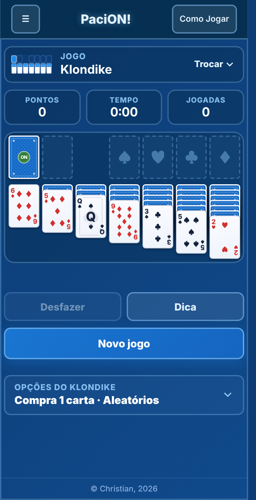
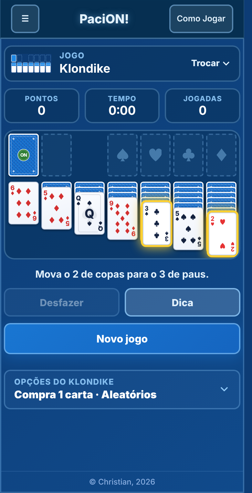
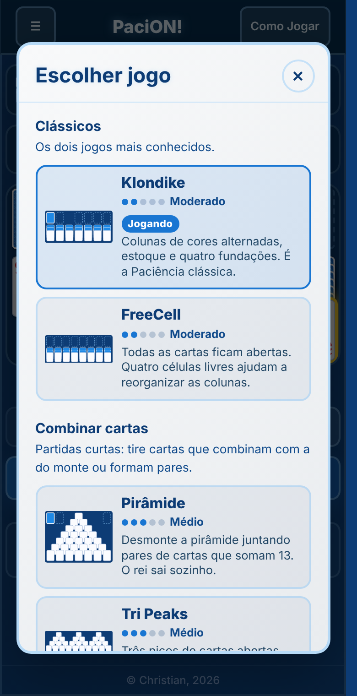
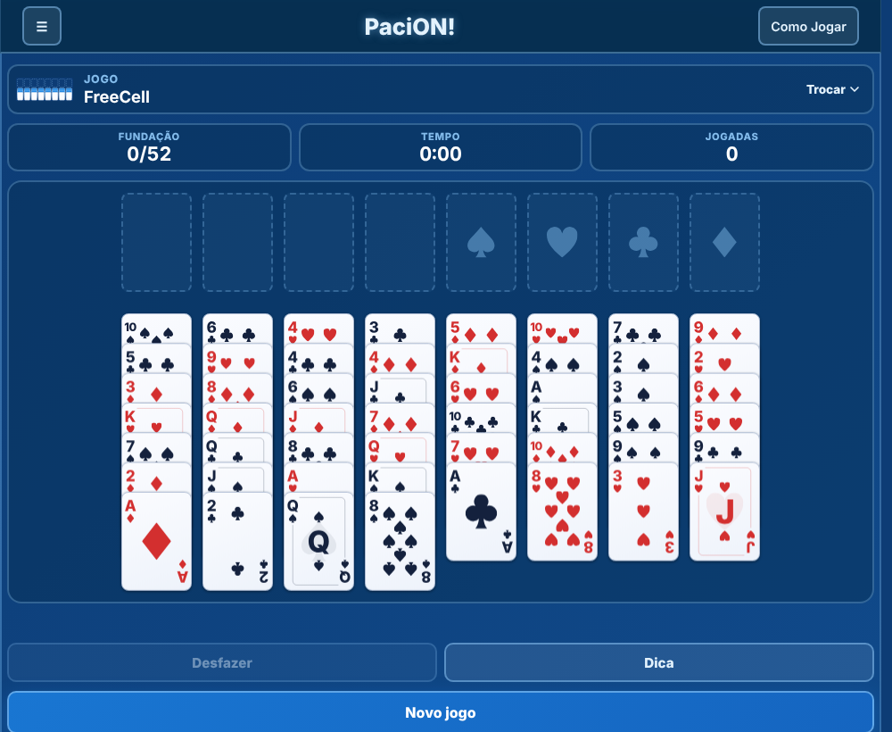

# PaciON!

13 jogos de Paciência com o visual da família ON!, para celular e computador: Klondike, Spider (1, 2 e 4 naipes), FreeCell, Pirâmide, Tri Peaks, Golf, Yukon, Canfield, Scorpion, Forty Thieves e Crescent. Todos têm dica, desfazer ilimitado e partida salva sozinha, e tudo funciona offline.

**Jogue:** https://pacion.netlify.app/ (confirme no Netlify se o subdomínio está livre) · **Mais jogos:** https://speccygames.netlify.app/

  
  &nbsp;&nbsp;
  
  &nbsp;&nbsp;
  

  

## Os jogos

| Jogo | Dificuldade | Ideia |
|---|---|---|
| Klondike | Moderado | colunas de cores alternadas, estoque e fundações. Compra de 1 ou 3, jogos aleatórios ou com solução |
| FreeCell | Moderado | tudo aberto, quatro células livres |
| Spider 1 naipe | Fácil | oito sequências de rei a ás do mesmo naipe |
| Pirâmide | Médio | pares que somam 13 |
| Tri Peaks | Médio | três picos, cartas um nível acima ou abaixo do monte |
| Golf | Difícil | limpar sete colunas, uma só passada |
| Spider 2 naipes | Médio | o mesmo jogo, com dois naipes |
| Crescent | Médio | oito fundações, quatro sobem e quatro descem |
| Yukon | Difícil | sem estoque, move qualquer carta aberta com o que está sobre ela |
| Canfield | Difícil | reserva de 13 e carta base sorteada |
| Scorpion | Difícil | sequências do mesmo naipe, estoque de 3 cartas |
| Spider 4 naipes | Muito difícil | o mesmo jogo, com os quatro naipes |
| Forty Thieves | Muito difícil | dois baralhos, uma carta por vez |

## Como jogar

| Ação | Como fazer |
|---|---|
| Escolher o jogo | botão no topo da mesa; cada jogo guarda a própria partida e as próprias estatísticas |
| Mover | arrastar a carta (ou o grupo) até o destino, ou tocar nela para o jogo escolher o melhor lugar |
| Pirâmide | tocar numa carta e depois na que forma o par (o rei sai com um toque) |
| Comprar | tocar no estoque; no Klondike e no Canfield, o espaço vazio vira o descarte de volta |
| Desfazer | volta quantas jogadas quiser |
| Dica | no Klondike, uma jogada que leva à vitória; nos outros, a melhor jogada do momento |
| Completar | aparece quando o resto é só mandar cartas para as fundações |
| Embaralhar | só no Crescent (9 por jogo) |
| Teclado | `Espaço` compra, `U` desfaz, `H` dica, `N` jogo novo |

O **Como Jogar** tem duas abas: usar o site, e as regras de cada jogo, um por um.

Pontuação (só no Klondike): descarte para coluna +5, para a fundação +10, desvirar carta +5, fundação de volta para coluna -15, virar o descarte -100 (compra de 1) ou -20 a partir da 3ª vez (compra de 3). Nunca fica abaixo de zero.

## Como funciona por dentro

| Arquivo | Função |
|---|---|
| `jogos.js` | motor dos 13 jogos (um objeto por jogo em `Jogos.MODOS`). Roda no navegador e no Node |
| `regras.js`, `solver.js` | motor e Web Worker do Klondike: dica "que leva à vitória" e jogos com solução |
| `javinhas.js` | mesa genérica, arrastar e tocar, seletor de jogos, Como Jogar, estatísticas |
| `cartas.js`, `cartas.css` | baralho da família ON!, em SVG (reutilizável em qualquer jogo de cartas, veja o `PADRAO.md`) |
| `colorido.css` | visual da mesa, do seletor e da ajuda |
| `on.css`, `on.js` | base compartilhada da família ON! (menu, sons, vibração, tema) |

Para criar mais um jogo, escreva um objeto novo em `Jogos.MODOS` (`layout`, `distribuir`, `podePegar`, `podeSoltar`, `venceu`...) e acrescente o id em `ORDEM`: a mesa, o seletor e a miniatura saem do `layout`.

Em telas bem estreitas (260px), os jogos de 10 colunas (Spider, Forty Thieves, Tri Peaks) ganham rolagem lateral na mesa, e ela rola sozinha ao arrastar uma carta perto da borda.

Fora o Klondike, a dica vem de uma heurística e não garante que o jogo tem solução.

Chaves do `localStorage`: `pacion.j.<jogo>`, `pacion.prefs`, `pacion.stats`, `pacion.cfg`. A partida do formato antigo (só Klondike) é convertida na primeira abertura.

## Publicar

Envie a pasta inteira para o Netlify. A cada mudança de arquivo, aumente a versão em `CACHE_NAME` no `service-worker.js` (hoje `pacion-v3`).
